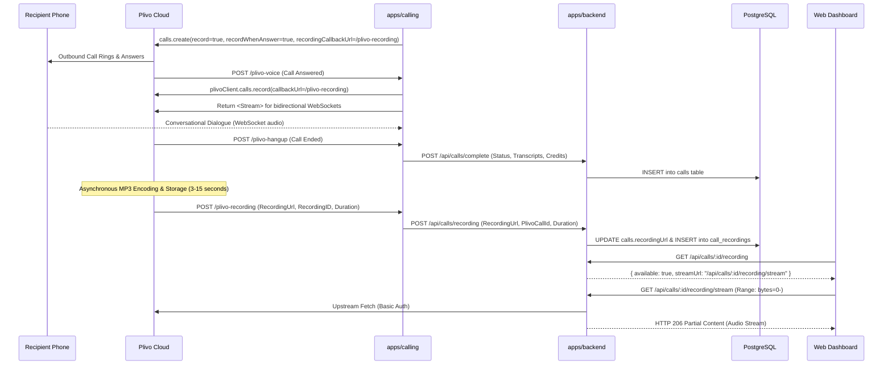

# Call Recording Architecture & Flow

This document details how call recording works across the Foolioo telephony and web services.

## Overview

Call recording in Foolioo bridges three key services:
1. **Plivo Telephony Infrastructure**: Captures audio streams from both caller and callee, mixing them into an MP3 file upon call completion.
2. **Foolioo Voice Engine (`apps/calling`)**: Controls live call execution, handles incoming audio streams, receives asynchronous recording webhooks, and forwards metadata.
3. **Foolioo Backend API (`apps/backend`)**: Stores metadata and playback URLs in PostgreSQL (`calls` and `call_recordings` tables) and acts as an authenticated audio streaming proxy.
4. **Foolioo Dashboard (`apps/frontend`)**: HTML5 `<audio>` player with seek, replay, and download support.

---

## Complete Lifecycle & Sequence

---

## Key Components

### 1. Recording Activation (`apps/calling`)
- **`dial.ts`**: Sets `record: true`, `record_when_answer: true`, and `recording_callback_url`.
- **`plivo-voice.ts`**: Triggers explicit call recording on answer with `fileFormat: "mp3"` and `callbackUrl: /plivo-recording`.

### 2. Asynchronous Callback Handling (`apps/calling`)
- **`plivo-recording.ts`**: Receives Plivo's webhook with `RecordingUrl`, `RecordingID`, and `RecordingDuration`.
- **`callDelivery.ts`**: Dispatches `dispatchCallRecording` to backend webhook (`POST /api/calls/recording`).

### 3. Metadata Persistence (`apps/backend`)
- **`updateCallRecordingRoute`**: Links recording to call via `deliveryId` or `plivoCallId`, updating `calls.recordingUrl` and inserting a row in `call_recordings`.
- **`callCompleteRoute`**: Duplicate webhook handler accepts late-arriving recordings and updates existing records.

### 4. Authenticated Streaming Proxy (`apps/backend`)
- **`streamCallRecordingRoute`**: Handles HTTP 206 byte-range requests and injects server-side Plivo credentials so private recordings can be played securely by the browser without exposing credentials.

### 5. UI Playback (`apps/frontend`)
- **`call-recording-player.tsx`**: Renders an accessible HTML5 audio player with time stamps, format badges, and a direct download link.
- **`calls-dashboard.tsx`**: Displays a "Recording" badge on the call history list.
